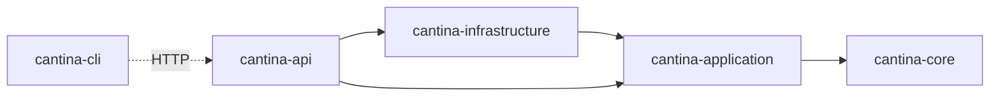

# CantinaSesi

Sabor Digital

CantinaSesi is a web platform for the SESI/SENAI school cafeteria. The entire
backend is written in **Rust** and follows a ports-and-adapters
(hexagonal) architecture: the API and the CLI are separate adapters that both
speak the same HTTP contract, so the frontend can be replaced at any time
without touching business rules.

## Workspace

```text
crates/
├── cantina-core/          Pure business concepts (no framework, no I/O)
├── cantina-application/   Use cases, DTOs, ports, typed errors
├── cantina-infrastructure/ Replaceable adapters (config, in-memory storage, ids, clock)
├── cantina-api/           HTTP adapter (Axum) and composition root
└── cantina-cli/           Administrative HTTP client (Clap + Reqwest)
docs/
├── api/catalog.md
├── api/catalog-administration.md
├── api/authentication.md
├── architecture/backend.md
└── decisions/
```

## Commands

```bash
cargo build --workspace
cargo run -p cantina-api
cargo run -p cantina-cli -- health
cargo run -p cantina-cli -- products list
cargo run -p cantina-cli -- products list --all
cargo run -p cantina-cli -- products show product_coxinha
cargo run -p cantina-cli -- categories list
cargo run -p cantina-cli -- auth login --email ana@example.com
cargo test --workspace
cargo fmt --all --check
cargo clippy --workspace --all-targets -- -D warnings
```

`products list` lists available products by default; `--all` (alias
`--include-unavailable`) also lists unavailable ones.

Authentication uses opaque bearer sessions with role-based access control. The
in-memory seed creates four demo accounts (see
`docs/api/authentication.md`); `auth login` prints an access token you can pass
with `--token`:

```bash
cargo run -p cantina-cli -- auth login --email ana@example.com --password-stdin \
  <<< "StudentDemo!2026"
cargo run -p cantina-cli -- --token "$TOKEN" auth me
cargo run -p cantina-cli -- --token "$TOKEN" auth refresh
cargo run -p cantina-cli -- --token "$TOKEN" auth logout
```

Administrative catalog mutations require a bearer token and enforce roles at
the application layer (products: Canteen/Admin; categories: Admin only):

```bash
cargo run -p cantina-cli -- --token "$TOKEN" products create \
  --name "Sanduíche natural" --description "Pão integral" --price-cents 1200 \
  --category-id category_snacks
cargo run -p cantina-cli -- --token "$TOKEN" products update product_123 \
  --name "Novo nome" --price-cents 1300
cargo run -p cantina-cli -- --token "$TOKEN" products enable product_123
cargo run -p cantina-cli -- --token "$TOKEN" products disable product_123
cargo run -p cantina-cli -- --token "$TOKEN" categories create --name "Combos"
cargo run -p cantina-cli -- --token "$TOKEN" categories update category_123 --name "Lanches"
```

Prices are always integer centavos (`--price-cents 1200` = R$ 12,00); products
are disabled via availability rather than deleted.

The read-only catalog endpoints are described in `docs/api/catalog.md`, the
administrative mutations in `docs/api/catalog-administration.md`, the
authentication contract in `docs/api/authentication.md`, and all of them in
the OpenAPI document served by the API at `GET /api/openapi.json`.

## How the pieces fit together

Rust powers the whole backend. The HTTP API (`cantina-api`) composes the
application services with the infrastructure adapters; the CLI
(`cantina-cli`) is a thin administrative client that talks to the running API
over HTTP — it never touches the database. Every future frontend (web, mobile,
desktop) connects to the same API contract.



`cantina-core` depends on no workspace crate; `cantina-application` owns the
ports the infrastructure adapters implement; `cantina-api` is the composition
root; `cantina-cli` is an HTTP client and never touches storage.

See `docs/architecture/backend.md` for the full architecture.
