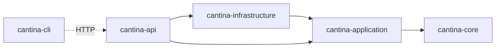
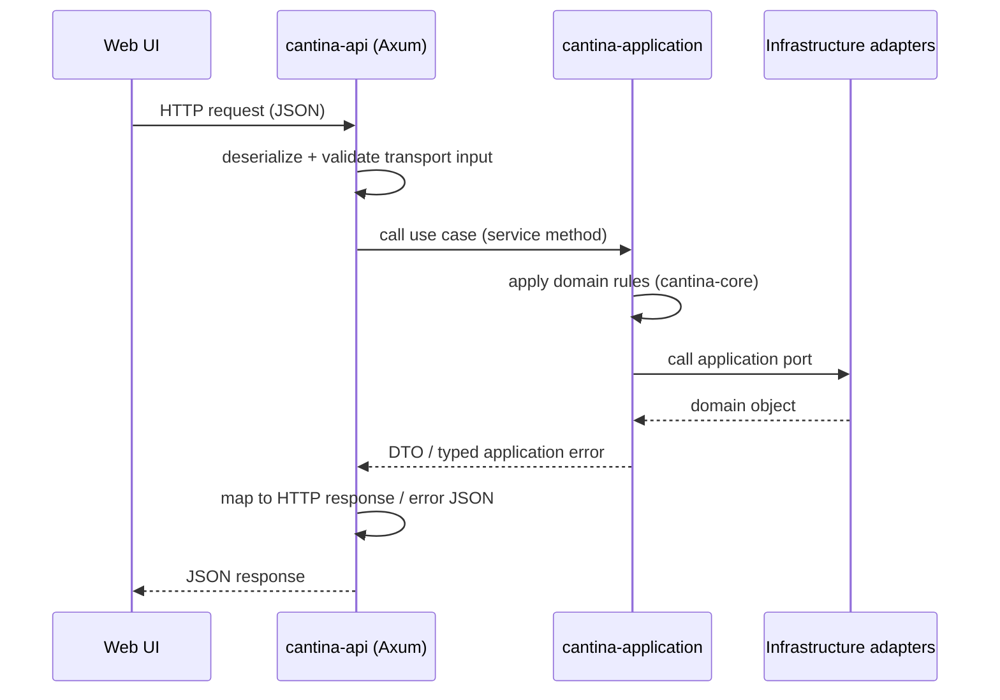
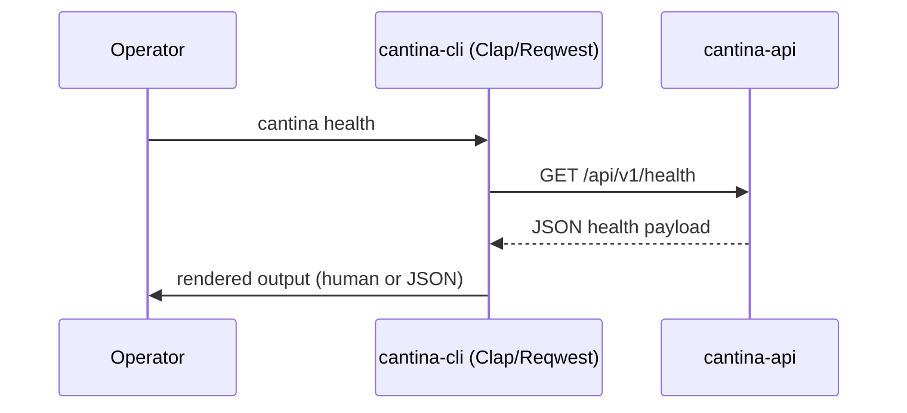
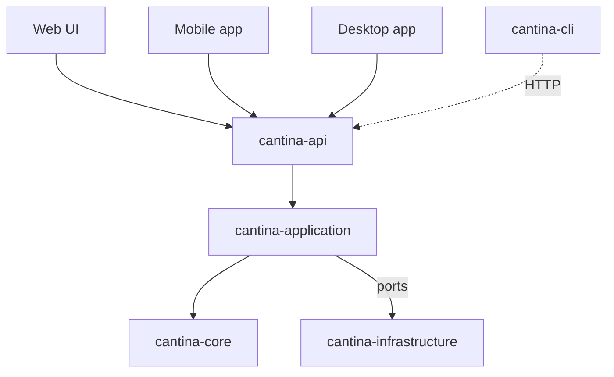

# Backend architecture

## Purpose

CantinaSesi is the web platform for the SESI/SENAI school cafeteria. Students
authenticate, browse products, place orders, track them and collect them with
a pickup code. Cafeteria staff manage products, view incoming orders and
advance them to ready/delivered.

This document describes the backend foundation: a Rust workspace shaped as a
ports-and-adapters (hexagonal) architecture. The single most important
property of this design is that **the user interface can be completely
replaced without touching any business logic**.

## Why the domain is independent from every UI

The domain (`cantina-core`) describes *what the cafeteria does*: who can order,
which statuses an order can take, which transitions are legal, what an order
costs. None of that depends on how the information is presented or delivered.

If the domain used HTTP terms, browser concepts or database models, then every
new UI would risk changing business rules. By keeping the domain free of
frameworks, the business rules are expressed once, tested once and reused by
every adapter.

## Why the browser uses HTTP instead of invoking the CLI

The Rust CLI (`cantina-cli`) is an *administrative client*. If the browser
spawned the CLI process it would:

* give the frontend direct control over a process on the server, mixing UI
  concerns with server execution;
* require frontend logic to understand CLI process management;
* make it impossible to replace the UI with a mobile or desktop app that
  cannot spawn server processes;
* bypass any authentication and authorization middleware that guards HTTP.

HTTP is the lowest common denominator that every frontend — web, mobile,
desktop — already speaks. The browser therefore only ever talks to
`cantina-api` over HTTP.

## Why the CLI is an API client

The CLI must not become a second server, must not access the database and
must not bypass application rules. It is a *thin administrative shell* over
the same HTTP contract the web UI uses:

* it never reads internal API files;
* it never instantiates infrastructure repositories;
* it never executes SQL;
* all it receives is structured JSON from `cantina-api`.

Because both the web UI and the CLI speak the same HTTP contract, the CLI is
one more replaceable client, not a special back door.

## Crate responsibilities

| Crate | Responsibility |
| --- | --- |
| `cantina-core` | Pure business concepts: entities, strongly typed identifiers, status machines, typed domain errors. Zero external dependencies. |
| `cantina-application` | Use cases and coordination. Defines commands, queries, DTOs, application errors and the ports (interfaces) that storage and services must implement. |
| `cantina-infrastructure` | Replaceable technical implementations: environment config, in-memory repositories (database later), clock, id and pickup-code generators, placeholder security adapters. |
| `cantina-api` | HTTP adapter and composition root. Builds the Axum router, wires application services to infrastructure adapters, translates application errors to JSON, owns CORS/tracing/graceful shutdown. |
| `cantina-cli` | Administrative HTTP client (Clap + Reqwest). Speaks JSON to `cantina-api` only. |

## Dependency directions

Allowed (strict, one way only):



* `cantina-core` depends on no workspace crate.
* `cantina-application` depends on `cantina-core`.
* `cantina-infrastructure` depends on `cantina-application` (and, transitively, `cantina-core`).
* `cantina-api` depends on `cantina-application` and `cantina-infrastructure` to compose the running service.
* `cantina-cli` depends on neither `cantina-infrastructure` nor the storage
  layer; it communicates with the API over HTTP.

Forbidden:

* `cantina-core` depending on anything else (no Axum, Tokio, Reqwest, Clap,
  database drivers, HTTP or JSON types, environment access).
* `cantina-application` depending on `cantina-infrastructure`, `cantina-api`
  or `cantina-cli`.
* `cantina-infrastructure` depending on `cantina-api` or `cantina-cli`.
* `cantina-cli` depending on `cantina-infrastructure` or any database driver.
* Any circular dependency.

## Application ports and infrastructure adapters

The application layer decides exactly what operations it needs and declares
them as traits in `cantina-application::ports`:

```text
UserRepository
ProductRepository
CategoryRepository
OrderRepository
CredentialRepository
SessionRepository
PasswordService
SessionTokenService
Clock
IdGenerator
PickupCodeGenerator
```

Ports are described in domain terms (`find_user_by_email`, `save_order`,
`list_products`, `list_categories`) — never in SQL terms (`execute_query`,
`insert_record`). The future database implementation adapts to these
interfaces; the application never adapts to the database.

`cantina-infrastructure` provides concrete adapters (`InMemory*Repository`,
`SystemClock`, `Generator`, `DefaultPickupCodeGenerator`) that implement those
ports. Replacing the in-memory repositories with a real database later is a
change confined to `cantina-infrastructure` and the composition root
(`cantina-api::bootstrap`).

## The HTTP contract

The API is versioned under `/api/v1` and described by an OpenAPI 3.1 document
served at `GET /api/openapi.json`. That document is the single source of truth
for the wire format: HTTP DTOs, never domain models or storage shapes. The
read-only catalog slice is documented by hand in `docs/api/catalog.md`.

List endpoints return `{"items": [...]}` envelopes, and every non-success
response uses a single `{"error": {code, message, request_id}}` envelope with
stable machine-readable codes. Invalid query strings answer `400` with the
`INVALID_QUERY` code.

## The web-to-API flow



The API never contains business rules, never queries storage directly and
never exposes database models. It only:

* deserializes and validates HTTP input;
* calls application use cases;
* translates application errors into HTTP responses;
* serializes response DTOs;
* extracts the bearer access token and authenticates the principal for
  protected routes (see `docs/api/authentication.md`).

## The CLI-to-API flow



## How a future mobile or desktop frontend integrates

A mobile app or desktop client needs no domain knowledge and no Rust at all.
It resolves the same base URL and speaks the same HTTP/JSON contract as the
web UI:



Adding a frontend is a client-side change. No crate in this workspace changes.

## Replacing the entire UI without changing business rules

Because every UI is a client of the stable HTTP contract:

1. keep the HTTP contract stable (see compatibility rules below);
2. build the new frontend against the same endpoints;
3. delete or archive the old frontend.

The domain, the use cases and the storage adapters are untouched. The only
component that even mentions the web is `cantina-api`, and even it could be
replaced by a different HTTP adapter (for example one exposing GraphQL or gRPC)
as long as it keeps calling the same application services.

## Compatibility principles

* additive response fields are allowed;
* removing or renaming fields requires a new API version;
* changing a field's meaning requires a new API version;
* clients must not depend on undocumented fields;
* domain models and HTTP DTOs are different concepts;
* frontend replacement must not require domain changes.

## Intentionally postponed database responsibilities

* selecting a real database engine;
* SQL migrations;
* ORM / query builder integration;
* real persistence for users, products, categories, orders and sessions.

The in-memory repositories exist only to start the API, run tests and
demonstrate dependency injection. A database is the next planned replacement
of those adapters.

## What should trigger future crate splitting or consolidation

* `cantina-infrastructure` grows a real database adapter and SQL migrations:
  split persistence into its own crate (for example
  `cantina-persistence-postgres`) if the base crate becomes a dependency hub.
* `cantina-api` grows pagination, rate limiting or event streaming
  middleware: consider splitting shared HTTP helpers into a dedicated crate.
* `cantina-application` starts aggregating many unrelated use cases: split by
  bounded context (`catalog`, `orders`, `users`) rather than by technology.
* The CLI and the API start sharing non-HTTP code: that code belongs in
  `cantina-application`, not in a new shared adapter crate.

Consolidate instead when a split crate only ever has a single implementation
or single consumer — speculative modularity is avoided on purpose.
