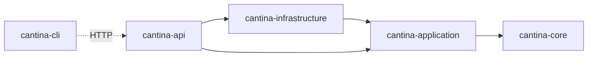

# ADR 0001: Foundation decisions

- Status: accepted
- Date: 2026-08-05

## Context

The backend foundation needs a few representation choices that ripple through
every crate. This record keeps them explicit so they are not re-litigated on
every change.

## Decision

### Strongly typed identifiers

All entity identifiers are strongly typed newtypes over `String`:
`UserId`, `ProductId`, `CategoryId`, `OrderId`. Raw integers and bare strings
are never used as identifiers in domain code. The string form (`order_123`)
is opaque; consumers must not parse it.

### Money as integer minor units

Prices and order totals are `u64` counts of minor units (centavos), never
floating point. This avoids rounding errors. The HTTP contract exposes the
same integer representation; formatting into a decimal string (for example
`18.50`) is a presentation concern and is deliberately not part of the API
contract yet.

### Domain crate is dependency-free

`cantina-core` has zero external dependencies. Errors are plain
`Display`/`Error` implementations; no `thiserror`, no serde. This makes the
"framework-independent domain" property verifiable by inspection.

### Ports are owned by the application layer

Repository and service interfaces live in `cantina-application::ports` and
are described in domain terms. Adapters in `cantina-infrastructure` implement
them. The reverse is forbidden.

`cantina-core` depends on no workspace crate. `cantina-api` composes the
application with the infrastructure adapters; `cantina-cli` is an HTTP client
of the running API only.

### No database yet

The foundation ships in-memory repository adapters only, for startup, tests
and dependency-injection demonstration. Picking a database, migrations and an
ORM is a separate, later decision confined to `cantina-infrastructure`.

### No real authentication yet

Passwords, JWT and sessions are out of scope. The domain exposes
`Principal` and `AuthError`; the application exposes `PasswordVerifier`,
`TokenIssuer` and an `AuthenticateUser` contract that returns a typed
"not implemented" error.

### HTTP contract is versioned and OpenAPI-described

The API lives under `/api/v1` and ships a machine-readable OpenAPI 3.1
document at `GET /api/openapi.json`. The document describes HTTP DTOs — never
domain models or storage shapes. No interactive UI is served.

### Collection responses use an envelope

List endpoints return `{"items": [...]}`. This leaves room to add pagination
metadata later without breaking clients that read `items`.

### Availability filtering is an application rule

`ProductRepository::list_products` returns every known product regardless of
availability; the `ListProducts` use case applies the availability filter
unless `include_unavailable` is requested. Adapters stay neutral so the same
data feeds both the public catalog and future administrative views.

### Invalid query strings are typed errors

A query the API cannot parse is answered with `400` and the standardized
`INVALID_QUERY` error code, not with a framework default body, so clients can
branch on the error code.

### The first vertical slice is read-only

Catalog V1 exposes products and categories for reading only. This forces the
read path (route → use case → port → adapter) to be built end-to-end before
any mutation exists, keeping the slice small and reviewable.

## Consequences

- Replacing the UI requires no domain or application changes.
- Replacing the storage requires changing only adapters and the composition
  root.
- Tests exercise the exact same ports production will use.
